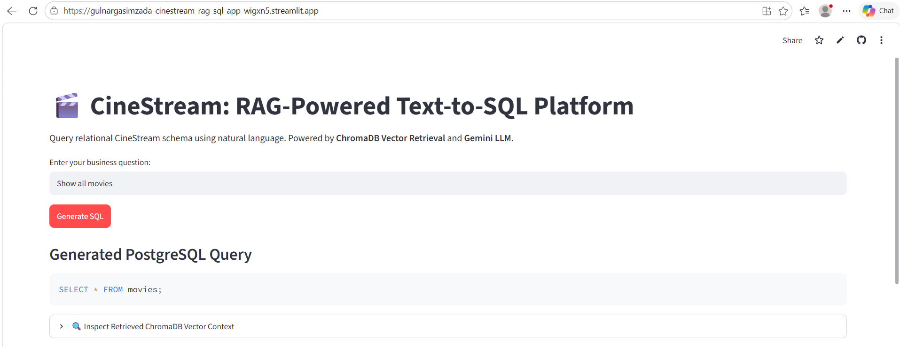
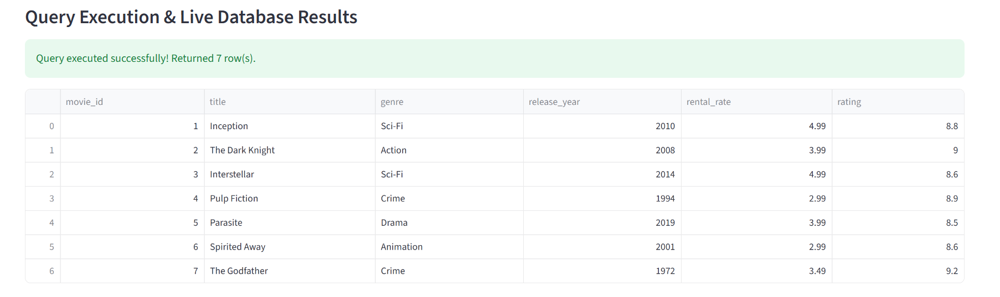

# 🎬 CineStream: RAG-Powered Text-to-SQL Platform

## 🌐 Deployed Application
* **Live Application URL:** https://gulnargasimzada-cinestream-rag-sql-app-wigxn5.streamlit.app

---

## 📌 Project Overview
This project transitions an interactive relational database testing tool into an autonomous **Retrieval-Augmented Generation (RAG)** Text-to-SQL platform. Users query a video streaming relational database containing `movies`, `customers`, and `rentals` schema using natural language. The system converts these questions into verified PostgreSQL queries, executes them live against a hosted cloud database, and tracks execution metrics.

---

## 🏗️ RAG Architecture & AI API Explanation

The system bridges unstructured business inquiries and relational PostgreSQL querying through a four-stage pipeline:

1. **Semantic Schema Storage (ChromaDB):**
   - An in-memory **ChromaDB** vector database stores domain descriptions, column definitions, data types, and join constraints across `movies`, `customers`, and `rentals`.
2. **Context Retrieval:**
   - When a user submits a natural language question, ChromaDB evaluates semantic embeddings and retrieves the most relevant schema documentation.
3. **SQL Synthesis via AI API (Google Gemini):**
   - The user query and retrieved context are supplied to the **Google Gemini API** (`gemini-2.5-flash` via the official `google-genai` SDK). A strict system prompt enforces standard PostgreSQL dialect rules without conversational filler or markdown code fences.
4. **Automated Live Database Execution & Audit Logging:**
   - The synthesized SQL is executed directly against the hosted **Supabase PostgreSQL** instance via SSL connection pooling (`psycopg2`), displaying tabular query outputs in the interface.
   - Each transaction (user query, generated SQL, execution status `SUCCESS` or `FAILED`, error trace, and timestamp) is recorded inside the persistent `query_audit_logs` database table.

---

## 🖥️ Instructions for Running and Using the Application

### 1. Launching the Interface
Open the deployed cloud application link directly in any web browser, or launch the application locally via terminal:
`streamlit run app.py`

### 2. Asking a Business Question
Type a question in plain English into the **"Enter your business question"** input field.

**Example queries:**
* "Show all movies"
* "Find movies with a rental rate higher than 3.00"
* "List customers with a Premium subscription"
* "Show total rental revenue per customer"

### 3. Generating and Inspecting the SQL
* Click the primary **"Generate SQL"** button.
* ChromaDB performs semantic vector retrieval against the schema knowledge base, and Gemini synthesizes the PostgreSQL query.
* The synthesized query is displayed in the **"Generated PostgreSQL Query"** block.
* *(Optional)* Click **"🔍 Inspect Retrieved ChromaDB Vector Context"** to inspect the schema documentation retrieved from the vector store.

### 4. Reviewing Live Database Execution & Audit Logs
* The platform automatically executes the SQL query against Supabase, displaying returned rows under **"Query Execution & Live Database Results"**.
* Expand **"📜 View Database Execution Audit Logs"** at the bottom of the page to review live execution tracking from the `query_audit_logs` table.

---

## 📸 Verification Screenshots

### Basic Requirement: Question & Generated SQL
A natural language query converted into an executable PostgreSQL query via vector retrieval and Gemini:

---

### Extra Credit: Executed SQL, Result Table & Audit Logging
Live Supabase query execution, tabular record display, and audit log tracking in `query_audit_logs`:

